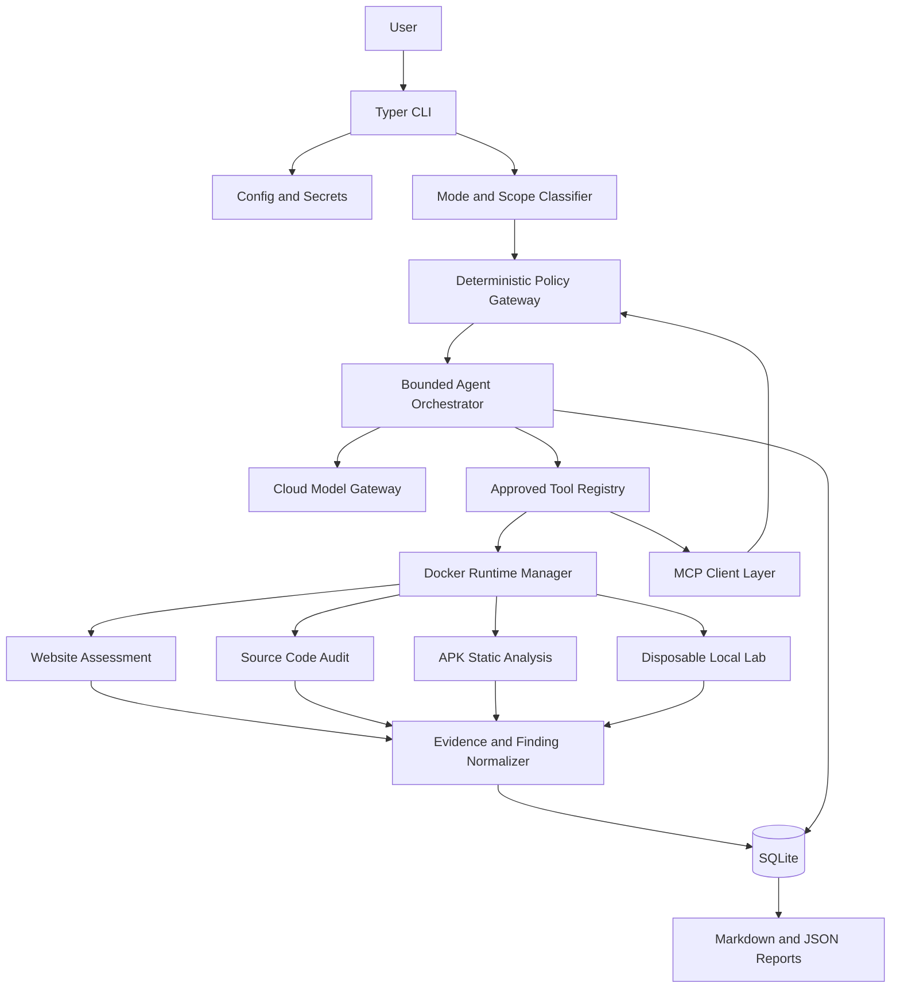

# MaubereSec AI — Technical Architecture (Python + Docker)

**Document ID:** MSAI-ARCH-002  
**Version:** 2.0.0  
**Status:** Revised baseline

## 1. Architecture decisions

- Core language: Python.
- CLI: Typer.
- Schemas/configuration: Pydantic.
- AI: cloud provider adapters only for the current baseline.
- Containers: Docker and Docker Compose.
- Persistence: SQLite initially.
- Tests: pytest.
- Logging: structlog or standard logging with JSON formatter.
- MCP: official Python MCP SDK, introduced after policy foundation.
- Scanner tools run as isolated subprocesses or containers through fixed adapters.

No Ollama/local inference path is included in this baseline.

## 2. Component diagram



## 3. Suggested Python dependencies

Use `pyproject.toml` and lock dependencies.

| Purpose | Suggested package |
|---|---|
| CLI | `typer` |
| Config/schema | `pydantic`, `pydantic-settings` |
| HTTP | `httpx` |
| Cloud AI | Provider SDK behind internal adapter |
| Database | `sqlalchemy` or `sqlite3` initially |
| Logging | `structlog` |
| Tests | `pytest`, `pytest-asyncio` |
| Lint/format | `ruff` |
| Type checking | `mypy` or `pyright` |
| CLI tests | `typer.testing` |
| Container integration | Docker CLI/Compose invoked through fixed wrapper |

Do not add a framework merely because it is popular. Keep the first version small and auditable.

## 4. Proposed repository structure

```text
mauberesec/
├── mauberesec/
│   ├── __init__.py
│   ├── main.py
│   ├── cli/
│   ├── config/
│   ├── ai/
│   │   ├── base.py
│   │   ├── manager.py
│   │   └── providers/
│   ├── agent/
│   ├── policy/
│   ├── scope/
│   ├── docker/
│   ├── mcp/
│   ├── tools/
│   │   ├── registry.py
│   │   ├── process_runner.py
│   │   ├── website/
│   │   ├── source_audit/
│   │   └── apk/
│   ├── findings/
│   ├── storage/
│   └── reports/
├── docker/
│   ├── Dockerfile
│   ├── compose.yaml
│   └── labs/
├── config/
│   └── mcp.example.yaml
├── docs/
├── tests/
│   ├── unit/
│   ├── integration/
│   ├── security/
│   └── e2e/
├── reports/
├── .env.example
├── .dockerignore
├── .gitignore
├── pyproject.toml
├── README.md
└── progres.md
```

## 5. Cloud model configuration

Example environment:

```bash
export MSAI_PROVIDER="openai"
export MSAI_MODEL="your-selected-model"
export OPENAI_API_KEY="your-api-key"

mauberesec models test
```

The actual model ID must be selected from the provider's current model list and configured by the user. Do not hardcode a model that may be retired.

Rules:
- Provider/model settings are explicit.
- API secrets are environment variables or secure secret-store values.
- No silent fallback to another provider.
- Local-only data processing mode can skip AI analysis.
- Before cloud submission, redact secrets and show the data disclosure.
- Provider adapter must enforce timeout and token/output limits.

## 6. Docker security baseline

Agent and scanner containers:
- Run as non-root.
- Drop Linux capabilities.
- Use read-only root filesystem where feasible.
- Set CPU, memory, PID, and timeout limits.
- Use dedicated networks.
- Mount only required input read-only and output writable.
- Never mount `/var/run/docker.sock` into agent/scanner containers.
- Never use `privileged: true` by default.
- Do not use host networking by default.
- Do not pass host secrets into scanner containers.
- Pin images for release.
- Keep lab services separate from the agent control plane.

The host Docker daemon remains a powerful boundary. The agent must not have direct Docker socket access. A narrowly scoped host-side runtime wrapper should accept only predefined lab and scanner profiles, not arbitrary Docker arguments from the model.

## 7. Mode enforcement

Mode classification is deterministic:
- `LIVE_WHITE_HAT`: any public target or uncertain target.
- `LOCAL_LAB`: only registered lab targets whose network and lifecycle are verified.
- `LOCAL_FILE`: explicitly selected local repository or APK.

A CLI option such as `--mode lab` is not sufficient. Verify target identity and destination at execution time, including redirects and DNS resolution.

## 8. Agent design

The model produces a structured plan. Python validates it against Pydantic schemas. The policy gateway checks every step before dispatch.

The model cannot:
- Run arbitrary shell commands.
- Modify scope or authorization.
- Change mode.
- Access Docker daemon directly.
- Read arbitrary host files.
- Install packages or tools.
- Override budgets.

Bounded run settings include max steps, calls, duration, request rate, concurrency, response bytes, and model tokens/cost.

## 9. APK pipeline

Initial static pipeline:
1. Validate path, file size, and APK signature/metadata where available.
2. Calculate SHA-256.
3. Copy the APK into a controlled input location.
4. Run approved static-analysis tools in a restricted container.
5. Parse manifest, permissions, exported components, network security settings, and static findings.
6. Redact secrets and normalize evidence.
7. Generate report.

Dynamic pipeline is deferred. It requires a disposable emulator or dedicated test device and a separate isolated network. Docker may orchestrate it, but emulator virtualization support is host-dependent.

## 10. Persistence

SQLite tables:
- assessments
- scopes
- tool_runs
- findings
- audit_events
- lab_registrations

Do not store API keys, passwords, cookies, private keys, or raw secret values.

## 11. Report structure

```text
reports/<assessment-id>/
├── report.md
├── report.json
├── findings.json
└── metadata.json
```

Each report includes target, mode, authorization reference, timestamps, tool versions, findings, evidence, confidence, remediation, limitations, and untested areas.
